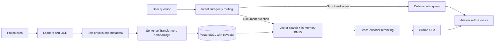

# ProjectLens

ProjectLens is a Vietnamese document assistant that helps users find, compare, and ask questions about project files. It combines document extraction, OCR for supported image content, hybrid retrieval, reranking, and a locally served large language model. Answers include source references so users can trace information back to the documents.

## Why and when to use it

Project information often sits across spreadsheets, contracts, technical specifications, and drawings. ProjectLens turns that collection into a searchable knowledge base and answers natural language questions against the indexed material. It is useful when a team needs to locate project facts, inspect document coverage, or retrieve cost and technical details without manually opening every file.

## Inputs and outputs

**Inputs**

- Documents placed in `documents/`: PDF, DOCX, PPTX, XLSX, XLS, CSV, HTML, JSON, text, and supported image files.
- Questions asked in Vietnamese or English, such as which project has the highest indexed cost or which files mention a drawing.
- Image OCR uses Tesseract. PDF text extraction reads the document's text layer; scanned PDF pages may need OCR preprocessing.

**Outputs**

- An answer grounded in indexed content, with document and sheet/page source information when available.
- Deterministic results for supported structured lookups such as project cost comparisons.
- Intermediate extracted chunks under `data/processed/`; PostgreSQL stores chunk text, metadata, and embeddings for retrieval.

## How data becomes an answer



1. Loaders extract text and source metadata from files; OCR reads text from supported images.
2. The ingestion pipeline cleans and splits content into chunks and writes JSONL intermediates.
3. The indexing command embeds chunks and stores text, metadata, and vectors in PostgreSQL/pgvector.
4. A question router directs supported structured questions to deterministic lookup logic. Other questions use vector retrieval and BM25 keyword matching, followed by reranking.
5. Ollama generates a response from the retrieved context, with citations to the source documents where available.

## Technology

- **Language and data:** Python, NumPy, Pandas
- **Document pipeline:** LangChain loaders, Tesseract OCR
- **Embeddings:** Sentence Transformers multilingual MiniLM model
- **Retrieval:** PostgreSQL, pgvector, in-memory BM25, cross-encoder reranker
- **Generation:** Ollama with `qwen3:8b` by default
- **Deployment:** Docker Compose for PostgreSQL, Ollama, and the application; Git for version control

This repository is a document RAG project. It does not currently implement general-purpose computer vision, time-series forecasting, TensorFlow models, or a LlamaIndex pipeline. OCR extracts text; it does not interpret engineering drawings as visual scenes.

## What Docker does here

Docker Compose provides a repeatable runtime for the database, Ollama, and application commands. PostgreSQL with pgvector persists document chunks and embeddings; Ollama serves the local language model. The application container runs ingestion, indexing, and question-answering commands against those services. Docker makes the services easier to start consistently; it does not improve answer quality by itself.

The compose file mounts `documents/` read-only and keeps processed data and database data in persistent volumes. Do not use `docker compose down -v` if you want to retain the database volume.

## Run locally with Python

Prerequisites: Python 3.12, Docker Desktop, and enough disk space for the embedding/reranker models and Ollama model. From the repository root in PowerShell:

```powershell
py -m venv .venv
.\.venv\Scripts\Activate.ps1
python -m pip install --upgrade pip
python -m pip install -e .
Copy-Item .env.example .env
```

Set the database settings in `.env` if needed, then start PostgreSQL and Ollama:

```powershell
docker compose up -d db ollama
docker compose exec ollama ollama pull qwen3:8b
```

Put source files in `documents/`, then ingest, index, and start the assistant:

```powershell
python -m project_lens.ingestion.chunk_documents_all_fixed
python -m project_lens.retrieval.build_postgres_index
python -m project_lens.retrieval.local_ollama_rag
```

The first run may download embedding and reranker models. Keep `.env` and private project files out of Git; they are intended to remain local.

## Run with Docker Compose

The same workflow can run through the application container. Start the services and fetch the Ollama model once:

```powershell
docker compose up -d db ollama
docker compose exec ollama ollama pull qwen3:8b
docker compose build app
docker compose run --rm app python -m project_lens.ingestion.chunk_documents_all_fixed
docker compose run --rm app python -m project_lens.retrieval.build_postgres_index
docker compose run --rm app
```

The final command starts the interactive assistant. The `app` service uses the same configured database and model service as the host workflow.

## Configuration

Copy `.env.example` to `.env` and configure the values for your environment. Common settings include:

- `DATABASE_URL`: PostgreSQL connection URL.
- `POSTGRES_DB`, `POSTGRES_USER`, `POSTGRES_PASSWORD`: compose database credentials.
- `OLLAMA_BASE_URL`: Ollama endpoint; the compose network uses the `ollama` service.
- `PROJECTLENS_LLM_MODEL`: generation model name, default `qwen3:8b`.
- `PROJECTLENS_DEVICE`: inference device selection for supported embedding/reranking components.

Use a strong database password outside local development. Never commit real credentials or confidential documents.

## Model serving and API deployment

Ollama is the current local inference service. Docker Compose runs the database and model service alongside the app for development and local use. To serve a trained model to other users, package the model behind an inference service and expose an authenticated API; callers send requests to that API rather than downloading the model. This repository does not currently provide a production API gateway, authentication, cloud deployment, or model optimization such as ONNX conversion and quantization.

## Inference performance

The repository includes an inference benchmark entry point:

```powershell
python -m project_lens.evaluation.benchmark_inference
```

It reports timing measurements for the configured pipeline. Results depend on the machine, model downloads, and workload; benchmarking does not itself optimize or quantize a model.

## Repository layout

```text
ProjectLens/
├── src/project_lens/
│   ├── ingestion/       # Load and chunk source documents
│   ├── retrieval/       # Indexing and RAG query pipeline
│   ├── knowledge/       # Structured domain lookups
│   ├── storage/         # PostgreSQL and pgvector access
│   ├── evaluation/      # Retrieval and inference evaluation tools
│   └── tools/           # Supporting utilities
├── documents/           # Local source files; not committed
├── data/processed/      # Local intermediate files; not committed
├── compose.yaml         # PostgreSQL, Ollama, and app services
├── Dockerfile
└── pyproject.toml
```

## Current limitations

- Retrieval and answer quality depend on source extraction, chunking, and metadata quality.
- Scanned PDF pages may need a separate OCR pass before indexing.
- The current BM25 index is built in application memory; PostgreSQL persists the chunks and vector embeddings.
- The system can only compare values represented in the indexed documents and supported structured lookup logic.
- Ollama inference is local by default; external API or production deployment needs additional service configuration.

## License

See the repository's license file, if present.
