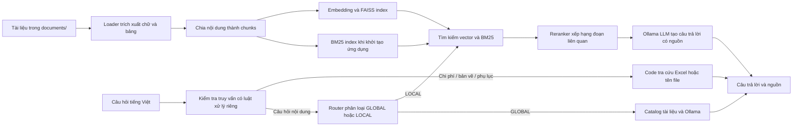

# ProjectLens

ProjectLens là ứng dụng RAG chạy cục bộ, giúp tra cứu hồ sơ kỹ thuật và hồ sơ dự án bằng câu hỏi tiếng Việt. Ứng dụng tìm đoạn tài liệu liên quan, đưa đoạn đó cho mô hình ngôn ngữ tạo câu trả lời và hiển thị nguồn để người dùng kiểm tra.

## Vì sao làm dự án này?

Hồ sơ dự án thường nằm rải rác trong PDF, Word, Excel và các định dạng khác. Tìm thủ công mất thời gian; hỏi một LLM không có tài liệu làm căn cứ có thể dẫn đến câu trả lời sai. ProjectLens lập chỉ mục tài liệu nội bộ để truy xuất bằng ngữ nghĩa và từ khóa, sau đó yêu cầu LLM trả lời dựa trên phần nội dung tìm được. Một số truy vấn có cấu trúc, chẳng hạn tìm tổng chi phí cao nhất, được xử lý trực tiếp từ Excel bằng code.

## Dùng khi nào?

- Khi cần hỏi đáp nhanh trên một tập hồ sơ dự án hoặc hồ sơ kỹ thuật.
- Khi cần tìm thông số, nội dung hợp đồng, tên dự án hoặc tài liệu có liên quan.
- Khi cần tra cứu dữ liệu có cấu trúc từ bảng tính, như so sánh tổng chi phí.
- Khi muốn chạy LLM và chỉ mục tìm kiếm trên máy cá nhân, không gửi ngữ cảnh tài liệu đến API LLM bên ngoài.

Chất lượng trả lời phụ thuộc vào tài liệu đã nạp, chất lượng trích xuất chữ, cách chia đoạn và kết quả truy xuất. Hãy mở nguồn được trích dẫn để xác nhận các con số hoặc quyết định quan trọng.

## Input và output

**Input**

1. Tài liệu nguồn đặt trong `documents/`. Loader hiện hỗ trợ PDF, DOCX, PPTX, XLSX, XLS, CSV, HTML, JSON, một số định dạng văn bản và ảnh. Ảnh cần Tesseract OCR; file `.xls` cần thư viện đọc Excel tương thích.
2. Câu hỏi tiếng Việt nhập trong giao diện dòng lệnh, ví dụ: “Dự án nào có tổng chi phí cao nhất?”

**Output**

- Câu trả lời sinh từ ngữ cảnh truy xuất được.
- Danh sách nguồn tài liệu và đoạn liên quan để kiểm tra.
- Với một số câu hỏi được code xử lý trực tiếp, kết quả tính/tra cứu có cấu trúc, ví dụ dự án có chi phí cao nhất hoặc tìm file bản vẽ theo tên.
- Dữ liệu trung gian: chunks trong `data/processed/` và FAISS index trong `data/vector_store_local/`.

## Quy trình từ input đến output



Các bước vận hành:

1. Loader đọc file được hỗ trợ; nội dung Excel được tách theo sheet, ảnh được OCR nếu máy có Tesseract.
2. Text splitter chia nội dung thành đoạn nhỏ có phần chồng lấn, giữ metadata như tên file và sheet.
3. Sentence Transformers tạo embedding; FAISS lưu vector để tìm kiếm tương đồng. Chạy lại bước này khi tài liệu nguồn thay đổi.
4. Khi khởi động chatbot, ứng dụng nạp FAISS, dựng BM25 từ chunks và nạp reranker.
5. Với câu hỏi thông thường, ứng dụng lấy ứng viên bằng tìm kiếm, reranker xếp hạng lại, rồi gửi các đoạn phù hợp cùng câu hỏi đến Ollama.
6. Ứng dụng trả lời và liệt kê nguồn. Một số nhánh như tìm chi phí cao nhất đọc trực tiếp Excel thay vì dựa vào suy luận của LLM.

## Công nghệ và phạm vi

- **GenAI:** LLM chạy qua Ollama, RAG, prompt hướng dẫn trả lời dựa trên nguồn.
- **Retrieval:** FAISS cho vector index, BM25 cho tìm từ khóa, Cross-Encoder để rerank.
- **Python stack:** Python, NumPy, Pandas, LangChain loaders/text splitters, Sentence Transformers.
- **Models mặc định:** `qwen3:8b` qua Ollama; `sentence-transformers/paraphrase-multilingual-MiniLM-L12-v2` để embedding; `BAAI/bge-reranker-v2-m3` để rerank.
- **OCR:** Tesseract cho ảnh được hỗ trợ.

> Dự án hiện tại không triển khai Computer Vision bằng OpenCV, dự báo Time-Series, TensorFlow hay LlamaIndex. OCR chỉ trích xuất chữ từ ảnh; không phải pipeline nhận diện/hiểu ảnh tổng quát.

## Deployment, tối ưu model và Git

### Inference pipeline

Inference được chia thành các bước có thể đo riêng: nạp FAISS/BM25, truy xuất ứng viên, rerank theo batch, rồi gọi Ollama sinh câu trả lời. Truy vấn chi phí, bản vẽ và phụ lục có nhánh xử lý theo dữ liệu thay vì gọi LLM. Có thể đổi model chat qua `PROJECTLENS_LLM_MODEL`, địa chỉ Ollama qua `OLLAMA_BASE_URL`, và thiết bị cho embedding/reranker qua `PROJECTLENS_DEVICE` (`cpu` mặc định; đặt `cuda` nếu môi trường PyTorch hỗ trợ GPU).

### Tối ưu hiệu năng

Pipeline giảm chi phí suy luận bằng cách chỉ rerank tập ứng viên từ FAISS/BM25 và chỉ đưa các đoạn đứng đầu vào LLM. Script benchmark đo p50/p95 latency và throughput của reranker theo batch size trên máy chạy thật; dùng kết quả để chọn batch size/device phù hợp. Benchmark hiện không giả định mức tăng tốc và chưa tự chuyển model sang ONNX hoặc quantization.

Chạy benchmark:

```powershell
python -m project_lens.evaluation.model_optimization_benchmark --device cpu --batch-sizes 1 4 8 16
```

### Chạy bằng Docker Compose

Docker chạy ứng dụng và Ollama thành hai service. Model Ollama được giữ trong named volume; `documents/` được mount chỉ đọc và `data/` được mount để giữ chunks/index trên máy host.

```powershell
docker compose up -d ollama
docker compose exec ollama ollama pull qwen3:8b
docker compose run --rm app python -m project_lens.ingestion.chunk_documents_all_fixed
docker compose run --rm app python -m project_lens.retrieval.build_vector_store_local
docker compose run --rm app
```

Lần đầu build image và tải embedding/reranker có thể mất thời gian. Lệnh cuối mở phiên hỏi đáp tương tác. Docker Compose cần được cài cùng Docker Engine/Desktop.

### Git và bảo vệ dữ liệu

Git quản lý source code, cấu hình mẫu và README. `.gitignore` loại `.env`, tài liệu trong `documents/`, dữ liệu sinh ra trong `data/`, môi trường ảo và artifact build để tránh đẩy secrets, hồ sơ nội bộ hoặc index lớn lên remote. Chỉ commit tài liệu mẫu đã được phép chia sẻ.

```powershell
git init
git status
git add README.md Dockerfile compose.yaml .dockerignore .gitignore pyproject.toml requirements.txt src
git commit -m "Document and containerize ProjectLens deployment"
```

Để đẩy lên GitHub, repo local cần được cấu hình remote trước bằng URL repo của bạn (`git remote add origin <URL>`), sau đó push branch hiện tại.

## Cấu trúc thư mục

```text
projectlens/
├── src/project_lens/
│   ├── ingestion/       # Đọc tài liệu và tạo chunks
│   ├── retrieval/       # Tạo FAISS index và chạy RAG
│   ├── knowledge/       # Chi phí, kiểm kê tài liệu, catalog
│   ├── evaluation/      # Benchmark RAG và model
│   ├── tools/           # Công cụ kiểm tra/chuẩn bị dữ liệu
│   └── paths.py         # Đường dẫn dữ liệu dùng chung
├── documents/           # Tài liệu đầu vào
├── data/
│   ├── processed/       # Chunks và dữ liệu xử lý
│   └── vector_store_local/ # FAISS index và metadata
├── pyproject.toml
├── Dockerfile
├── compose.yaml
└── requirements.txt
```

## Cài đặt và chạy (PowerShell)

Yêu cầu Python 3.10 trở lên, Ollama và đủ bộ nhớ để chạy embedding/reranker. Tạo môi trường ảo rồi cài package:

```powershell
py -m venv .venv
.\.venv\Scripts\Activate.ps1
python -m pip install --upgrade pip
python -m pip install -r requirements.txt
```

Tải model chat về Ollama và đặt tài liệu được phép xử lý vào `documents/`. Sau đó tạo chunks, lập chỉ mục và chạy chatbot:

```powershell
ollama pull qwen3:8b
python -m project_lens.ingestion.chunk_documents_all_fixed
python -m project_lens.retrieval.build_vector_store_local
python -m project_lens.retrieval.local_ollama_rag
```

Lần đầu chạy, Sentence Transformers tải model embedding và reranker. Nếu thêm/sửa/xóa tài liệu, chạy lại bước chunking và tạo FAISS index trước khi khởi động chatbot. Kiểm tra log chunking để biết file nào bị bỏ qua hoặc không đọc được.

## Giới hạn đã biết

- RAG có thể bỏ sót dữ liệu nếu PDF scan, bảng tính hoặc OCR trích xuất kém.
- Câu trả lời tổng hợp phụ thuộc vào các đoạn bộ truy xuất lấy được; hãy đối chiếu nguồn với tài liệu gốc.
- Lần khởi tạo có thể tốn thời gian vì cần nạp model embedding và reranker.
- Chưa có đánh giá tự động đủ rộng để khẳng định độ chính xác cho mọi loại câu hỏi.

## Phát triển package

Mã nguồn dùng `src` layout; cài đặt editable giúp Python import package từ `src/` khi chạy các lệnh `python -m`. Cách bố trí này tách package được import khỏi file cấu hình ở thư mục gốc và giúp phát hiện sớm lỗi đóng gói/import. [Python Packaging User Guide](https://packaging.python.org/en/latest/discussions/src-layout-vs-flat-layout/)
